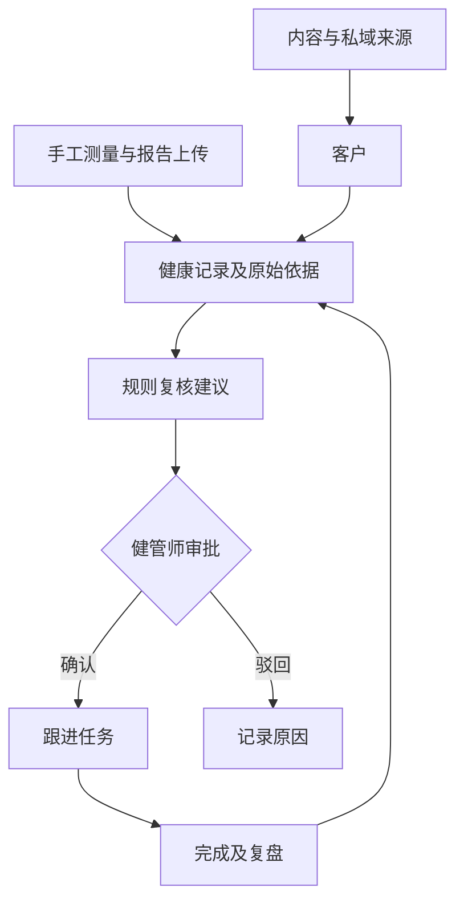

# 首版产品定义

需求依据：[历史对话](./sources/2026-09-28-历史对话.txt)、[旧架构](./ARCHITECTURE.md)。以下是本轮实现与后续建议的区分，实际运行入口见 [README](./README.md)。

## 收敛后的方向

Creator 是公司与平台品牌；长寿诊所智能健管是第一垂类。先验证一个闭环：健康记录 → 有依据的复核建议 → 健管师审批 → 跟进任务 → 复盘积累。

获客和健康服务共享客户标识，但分开管理授权与用途。短视频、直播、图文、课程的来源信息进入客户关系；健康测量和报告进入健康档案。首版的“数字孪生”指持续更新的纵向档案，不宣称能够模拟人体或预测疾病。

## 本轮数据模型

| 对象 | 关键关系/字段 | 当前实现 |
| --- | --- | --- |
| Patient | 内容来源、私域渠道、负责人、目标 | 三名演示客户；可检索及查看 |
| Observation | 客户、指标、单位、来源、测量时间 | 六类指标录入与历史趋势 |
| Report | 客户、原始文件、状态、时间 | 文件上传/下载，待人工解读 |
| Recommendation | 客户、依据、状态、复核说明 | 规则生成及审批，不是 LLM 推理 |
| Task | 客户、唯一建议关联、状态、复盘 | 批准后创建、完成后记录反馈 |
| Event | 客户、事件类型、载荷、时间 | 跟踪业务动作，尚非防篡改审计系统 |

未实现通用实体注册器、关系图引擎、行业模板执行器。上述关系数据库是验证垂类闭环的基础，不把它宣称为完整 Ontology 平台。

## 底层正式版本的约束

- PostgreSQL 中按 tenant_id 隔离全部对象及文件；租户来自经验证身份，不接受客户端任意指定。
- 外部设备身份先映射到租户内客户，不能凭姓名自动合并。
- 指标按窄表存储，保留原始值/单位、标准值/单位、来源、时间、数据质量、外部事件 ID；唯一约束处理重复导入。
- 医疗报告结构化结果需逐项人工复核；保留原文定位、参考区间与实验室口径。
- 设备读数可产生“需复核”信号；健康风险模型需独立验证，不制造综合健康分和虚假预测精度。
- 干预方案区分草稿、审核、生效、结束；保存每次版本及前后指标，不把相关变化自动归因于干预。
- 模板复用字段、关系、流程、规则与测试；跨机构不自动汇总个人健康资料。

## 页面与设计依据

本轮无 Refero 在线检索工具，使用已安装 refero-design 的 typography、color、craft-details 三份参考。用户手机端需求决定单列优先、底部导航；桌面扩展双列。

| 决策 | 依据 | 用途 |
| --- | --- | --- |
| 中性系统字体与大数字 | typography：工作工具重可读性与扫描 | 快速查看指标及单位 |
| 浅灰背景、白色面板、深青主色 | color：单一主色与明确语义色 | 强调主要行动，警示保留琥珀色 |
| 原生表单、可见焦点、提交状态 | craft-details：标签、键盘与错误反馈 | 手机上可准确录入 |
| 首页“已记录指标”环形图 | 用户动态档案需求 | 表示覆盖数，不伪装健康评分 |
| 审批与反馈分两步 | 用户要求人工最终决策 | 留下理由并防重复执行 |

## 试点验收建议

首先测量健管师每天整理数据耗时、建议处理时长、任务完成率、复盘记录完整率。试点前记录基线和统计口径，再比较同口径结果。营收、转化率和疾病风险预测不作为此演示版本的已验证收益。
