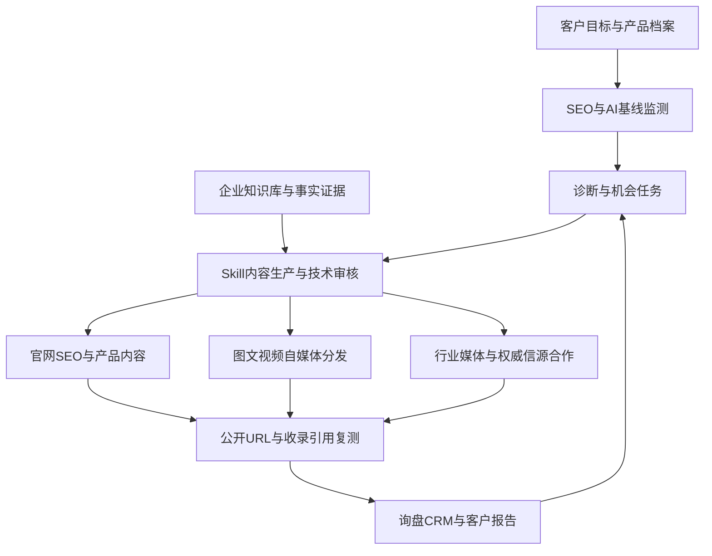

## For future Claude
An integrated client delivery system blueprint for manufacturing B2B GEO and website SEO, prepared on 2026-10-01. It combines monitoring, diagnosis, structured enterprise knowledge, content skills, website implementation, article/video distribution to 12 Chinese channels, paid media procurement, and lead attribution. Recommendations and trial budgets are planning assumptions; public documentation was inspected but no client systems, accounts, media orders, or publishing were activated.

## 方案定位

产品名称建议：制造业 B2B 数字内容与 AI 搜索增长交付平台。

业务目标：让企业与产品被找到、被准确理解、进入采购备选名单，并产生可跟进的商业询盘。

用户已确认：先建通用交付底座，不限定首批制造业细分行业。行业差异通过产品字段、术语、问题模板、内容审核规则和媒介配置包实现。

延续 [[2026-10-01-GEO-enterprise-delivery]] 与 [[2026-10-01-Manufacturing-GEO-delivery-blueprint]]；本文件是集成后的客户交付 V1 方案。

## 1. 三个产品界面

| 界面 | 使用者 | 核心功能 |
|---|---|---|
| 运营交付台 | 项目经理、SEO、编辑、技术审核、媒介人员 | 多客户项目、诊断、知识、生产、任务、排期、采购、费用 |
| 客户工作台 | 客户市场、产品工程师、管理者 | 补资料、核准事实、审稿、批准媒体预算、看成果与询盘 |
| 执行服务 | 定时任务与工具 | 采样、爬取、解析、生成、校验、发布、URL 核查、报告 |

共用：租户与权限、账号授权、版本、审计记录、任务重试、额度、成本和数据导出。

## 2. 完整业务闭环

四条链同步建立：事实证据链、内容版本链、发布与引用链、询盘与商机链。

## 3. 功能模块与客户交付物

| 模块 | 系统能力 | 客户交付物 | 优先级 |
|---|---|---|---|
| 客户与产品中心 | 目标国家、语言、产品线、采购角色、竞品、权限 | 项目范围和目标清单 | P0 |
| 综合监测 | 网站可用、抓取、收录线索、搜索表现、AI回答与引用、竞品 | 基线和趋势报告 | P0 |
| 诊断与任务 | 技术SEO、内容缺口、品牌事实错误、引用缺口；按收益/成本排优先级 | 有责任人和验收条件的整改清单 | P0 |
| 企业知识与事实库 | 产品参数、手册、案例、认证、素材、中英术语、公开级别 | 可核验的企业知识资产 | P0 |
| Skill内容工作台 | 检索、选题、主稿、校验、技术审核、翻译、渠道改编 | 核准主稿与多格式发布包 | P0 |
| 网站SEO实施 | 页面模板、结构、内链、元信息、重定向、性能、CMS变更 | 已上线页面与修改记录 | P0 |
| 图文视频发布中心 | 渠道账号、排期、格式校验、发布、回执、重试和人工接管 | 发布台账和公开URL | P0/P1 |
| 信源与媒介中心 | 引用域名库、媒体分类、有效报价、采购、审稿、链接核验 | 媒介组合、订单和凭证 | P0登记/P1采购 |
| 内容维护中心 | 参数/认证/型号变更触发影响分析；链接、引用与内容衰减检查 | 需更新页面和稿件清单 | P1 |
| 转化与销售协同 | 表单、资料下载、样品/选型/报价请求、CRM、来源标签 | 有效询盘及跟进清单 | P0基础/P1集成 |
| 实验与复盘 | 固定问题集、重复采样、分组比较、内容版本与变更时间 | 可复查效果分析 | P0基本/P2实验 |
| 经营与客户报告 | 套餐、工时、API与媒体成本、预算、月报和续费 | 交付报告与项目利润 | P0基础/P1完整 |

## 4. 监测设计

### 4.1 网站SEO监测

- 正常访问、HTTP状态、robots/noindex、canonical、sitemap、重定向、坏链、重要内容是否可解析。
- 中英文页面与hreflang，标题/描述、页面重复、内部链接、产品页完整度、图片与视频文字说明。
- 性能与移动端体验，重要表单能否完成，联系信息是否一致。
- 授权连接Google Search Console、Bing站长及百度相关站长工具；只接平台实际提供的数据，不假设有统一开放API。
- 排名和可见度按地域、语言、设备与查询集记录；排名检查可以采用供应商接口并单独计费。

### 4.2 AI监测

消费者目标：豆包、腾讯元宝、Kimi、DeepSeek、ChatGPT、Grok；Claude聊天产品可作为补充。Claude Code保留为开发者资料/工具触达方向，不与普通聊天品牌曝光混算。

每次采样保存：平台产品、采集方式、地区、语言、账号条件、问题与版本、是否联网、时间、模型标识（若可得）、原始回答、来源、错误与成本。

模型API、消费者网页/App、人工抽样分别呈现；只有实际获得的来源才记作引用。不能把模型生成的一条普通URL自动视作平台检索引用。

### 4.3 问题集

分组：品牌认知、非品牌采购、产品选型、应用场景、技术对比、安装维护、供应商筛选。

示例：如何选择耐腐蚀计量设备；某工况适合何种材料；工业通信模块选型看哪些参数。按客户产品和地区生成，示例不代表已知客户事实。

非品牌问题是观察自然被推荐的重要集合；包含品牌名的问题用于准确性检查，不能混入非品牌推荐率。

固定基线与新增探索问题分开。重点问题重复采样，失败不计未提及，同时披露成功率；不把单次波动当成确定增长。

## 5. 诊断必须变成可执行任务

任务字段：问题类型、影响URL/型号/问题集、证据、优先级、预计工时、负责人、客户依赖、到期日、改动版本、验收方法、复测日期。

| 发现 | 动作 | 验收 |
|---|---|---|
| AI对型号参数描述错误 | 核实事实、修复官网产品页、更新公开资料 | 事实更正已上线，按原问题复测；不能保证外部平台立即更新 |
| 官网只有扫描版手册 | 解析并核准参数，增加HTML产品摘要与FAQ | 核心信息可访问、可解析，来源可追溯 |
| 竞品被某技术页引用而客户缺席 | 分析该页主题和编辑条件，补足对应内容并提出合作 | 合格内容与合作结果留证；不承诺获得引用 |
| 报价页有访问无提交 | 调整表单和资料承接 | 转化事件可记录，表单可完成，按周期评估 |
| 旧认证被多篇稿件继续使用 | 找出关联内容并更新/申请修订 | 自有内容已更新，第三方处理状态清楚 |

## 6. 知识库与Skill内容工厂

### 6.1 知识结构

企业实体 -> 产品系列 -> 型号 -> 参数与工况 -> 证据来源 -> 应用案例 -> 采购问题 -> 内容资产。

向量检索负责找证据，结构化字段负责参数精度。每条事实保存来源文件版本、页码/表格、原文、值、单位、适用范围、有效期、公开级别和核准人。

提取结果未经核准不自动升级为公开事实；证据不足输出待补项。品牌别名、英文名、域名、型号统一管理，减少多个渠道自相矛盾。

### 6.2 首批Skill

1. 资料解析与产品卡整理。
2. 采购意图和问题研究。
3. 内容主题组与关键词规划。
4. 证据检索与大纲生成。
5. 技术文章/选型/案例写作。
6. 参数、单位、工况、认证和来源校验。
7. 中英术语一致性与本地化。
8. 图文排版、封面、摘要和渠道适配。
9. 视频脚本、镜头清单、字幕和图文转视频。
10. 官网SEO变更建议与发布包。
11. 渠道发布与回执处理。
12. AI复测与客户月报。

每个Skill包含输入schema、工具权限、知识范围、输出schema、评测样本、版本、成本上限和失败路径。Agent编排这些步骤，不依赖一个超长提示词处理全部工作。

### 6.3 图文与视频资产

一个主题先形成经核准主稿，再派生官网页、问答、公众号文、行业投稿、英文版、摘要和视频脚本。

视频以真实产品、工厂、测试和案例素材为主，AI辅助脚本、字幕、翻译、剪辑和说明动画。生成画面不能冒充真实工厂、测试记录或客户案例。

视频包包括成片、封面、字幕、标题/简介、文字稿、关联产品页。不同渠道派生内容与原创主稿分别计量。

## 7. 网站SEO要交付实施

### 页面体系

- 品类页、产品系列页、型号参数页。
- 工况/行业应用页、选型指南、技术对比、故障与维护页。
- 可公开案例、资质与测试方法、企业与工厂信息。
- 中英文术语一致的对应页面。
- 资料下载、选型咨询、样品申请、询价入口。

### 实施流程

先做全站基线，产出变更单；客户现有CMS允许时创建草稿/预览，测试后按授权发布，保存修改前后版本与回滚方案。影响大量URL的重定向、模板和索引规则变更设置专门审核，不作为无人监督批量动作。

技术项：标题/描述、合理H结构、内容内链、canonical/hreflang、sitemap、图片信息、HTML可读性、性能。结构化数据与可见事实一致，按页面使用适合的类型，不伪造报价、评价或资质。

2026-10-01核查：[Google AI features文档](https://developers.google.com/search/docs/appearance/ai-features)明确SEO基础仍适用，不要求特殊AI文本文件或专有Schema；不能把llms.txt等同排名手段，也不把FAQ富结果承诺写入合同。

[IndexNow文档](https://www.indexnow.org/documentation)提供URL更新通知机制，成功响应是提交成功，不是索引或排名成功；仅对支持的搜索引擎使用，不宣传成全平台收录接口。

## 8. 12个自媒体平台矩阵

以下覆盖用户给出的全部12个平台。优先级为通用工业B2B建议，按客户受众调整。适配支持来自2026-10-01的项目公开文档，尚未实测全部账号。

| 平台 | 内容定位 | 接入候选 | 建议 |
|---|---|---|---|
| 微信公众号 | 深度技术、案例、客户培育 | 官方草稿/发布API；Wechatsync辅助 | 核心 |
| 知乎 | 选型、工况、技术路线问答 | Wechatsync草稿及发布流程验证 | 核心 |
| 百家号 | 产品应用、知识解释 | Wechatsync图文；视频另验 | 核心候选 |
| 搜狐号 | 品牌与应用文章 | Wechatsync | 扩展 |
| 头条号 | 行业知识、制造现场 | Wechatsync | 扩展 |
| 网易号 | 行业与品牌内容 | Wechatsync | 扩展 |
| 企鹅号 | 可选图文/视频渠道 | 当前适配未验证，先发布包/人工执行 | 后接 |
| CSDN | 工业软件、嵌入式、通信、开发文档 | Wechatsync | 技术产品启用 |
| 哔哩哔哩 | 安装、演示、测试、工程教程 | Wechatsync专栏；social-auto-upload视频 | 有素材时核心 |
| 小红书 | 可视化产品、工厂、设计应用 | Wechatsync图文；视频工具另验 | 匹配受众启用 |
| 抖音 | 设备工艺、工厂演示 | social-auto-upload视频；图文另验 | 有素材时启用 |
| 简书 | 通用知识补充分发 | Wechatsync | 低优先级 |

中文工具来源：[Wechatsync](https://github.com/wechatsync/Wechatsync)、[social-auto-upload](https://github.com/dreammis/social-auto-upload)。微信发布权限参见[官方文档](https://developers.weixin.qq.com/doc/offiaccount/Publish/Publish.html)，按账号实际授权验证，发布不等于群发。

海外另增加中英文官网、LinkedIn、YouTube、X；用[Postiz](https://github.com/gitroomhq/postiz-app)或正式API评估，不与国内12个平台混计。

### 发布状态与可靠性

状态：待核准 -> 已批准 -> 已排期 -> 执行中 -> 草稿已同步/审核中 -> 公开发布；另有失败、待人工、撤回。

- 按租户隔离凭证与浏览器登录态，不共用跨客户Cookie。
- 发布前检查型号、事实版本、链接、图片/视频和渠道限制。
- 自动化只发布得到授权且已核准的内容版本；内容变化触发重新审核。
- 使用幂等键、状态查询和退避重试，防止重复发文。
- 验证码、登录过期和不确定结果转人工；不能假报成功。
- 平台任务ID、URL、时间、回执、公开可访问检查均保存。
- 知识更新后对关联稿件发出修订任务；不自动删除外部内容。

## 9. 权威信源与付费媒体

### 9.1 信源分层

| 层 | 内容 | 获取路径 | 解释边界 |
|---|---|---|---|
| 原始证据 | 认证机构可查询记录、公开标准、专利信息、研究和测试 | 真实业务形成与核验 | 不是付费软文版位；适用范围要准确 |
| 机构公开资料 | 行业协会、展会主办方、科研/合作单位公开信息 | 会员、参展、联合项目、经核准案例 | 不能捏造官方推荐或借名称暗示背书 |
| 编辑型行业媒体 | 技术报道、应用文章、访谈、测评 | 编辑投稿或明确标注的商业合作 | 投稿不保证通过，商业合作不等于独立报道 |
| 企业自媒体与商家页 | 自主发布的信息 | 自己管理的账号 | 可被引用，但不是独立第三方背书 |
| 新闻稿分发与转载 | 企业新闻稿及传播 | 付费分发 | 同稿转载不算多个独立证据来源 |

没有可通用于所有AI的官方“信任分”。系统展示来源类型、证据质量、目标问题中的实际引用频率和内容留存，不包装成客观AI权威评级。

### 9.2 第一批渠道候选

| 候选 | 适合方向 | 建议采购方式 | 当前核验 |
|---|---|---|---|
| [工控网](https://www.gongkong.com/) | 工业控制、自动化、设备、智能制造 | 先核查厂商/资料权益、技术案例投稿；再询单次合作 | 官网可见厂商、产品、案例、技术资料；未取得报价 |
| [OFweek](https://www.ofweek.com/) | 新能源、电子、光电、机器人等 | 区分维科号自发内容与编辑频道；试单匹配行业栏目 | 官网已核查；未核验具体编辑合作和价格 |
| [C114通信网](https://www.c114.com.cn/) | 通信、工业互联网、网络设备 | 技术选题投稿/行业内容合作候选 | 官网可见投稿入口、相关栏目与媒体信息；未询价 |
| 行业协会/展会官网 | 按产品行业选择 | 使用真实会员/参展权益，申请产品与技术资料展示 | 未定行业，不预先指定一个协会或承诺权益 |
| [美通社](https://www.prnasia.com/) | 重要新品、认证、展会与出海新闻 | 季度或专项评估，按地区和分发范围询价 | 官方分发业务已核查；未取得报价，不归为低价常规渠道 |
| [Thomas](https://business.thomasnet.com/) | 面向北美的工业供应商发现 | 先核对公司资料收录资格，再评估Sponsored Listings | 官方商业页面已核查；非通用官方媒体，不承诺所有客户可入驻 |

中国工业新闻网/中国工业报、赛迪相关渠道可保留为进一步核验候选。本次对应网站抓取分别出现循环重定向、TLS错误，未完成主体及商业权益核查；不放进已确认可采购清单。仪器信息网、电子工程世界等也需另核，当前访问失败。

“官网能访问”“能注册发稿”“媒体编辑投稿”“付费广告版位”是不同能力，报价单必须标清。

### 9.3 低预算策略与组合

优先顺序：自有官网与企业账号 -> 已有会员/展会/合作伙伴权益 -> 1个行业相关渠道的小额试单 -> 有新闻价值时做专项分发。

不默认采购大量泛门户套餐；同样一笔预算，优先比较行业相关内容、实际版位与可追踪询盘。

| 套餐结构 | 内容 | 适用 |
|---|---|---|
| 基础信源建设 | 品牌信息统一、官网证据页、现有机构目录/展会资料完善、技术投稿准备 | 预算有限、基础资料不完整 |
| 行业试投 | 1个相关行业渠道单次合作 + 对应官网落地页 + 自媒体派生 + 30天复盘 | 验证渠道价值 |
| 重要事件传播 | 新品/展会/认证事实材料 + 行业报道合作 + 可选新闻稿分发 + 销售跟进 | 有真实新闻事件 |

若需要一个试点预算锚点，可先设每客户每月人民币3,000-5,000元的外部媒介试验上限，不含内容制作和代运营。这是内部预算假设，不是以上媒体报价，也不保证该预算能买到指定媒体资源。收到真实报价后缩减数量或改用已有权益，不为花完预算买低质资源。

### 9.4 采购和验收

媒介SKU字段：真实站点/账号/版位、发布主体、编辑或广告、行业与地域、可访问性、可抓取条件、标题/正文修改权、外链、留存期、交付时间、报价币种/含税状态/有效期、退款补发、报告口径。

三类验收分开：

1. 可控交付：约定内容、版位、上线日期、URL、留存。
2. 传播观测：阅读、点击、下载、询盘；供应商自报与自有统计分列。
3. 搜索/AI观测：收录证据、引用与提及变化，不以供应商“保收录/保AI排名”的口头说法代替证据。

付款前保留客户批准的具体渠道、总额与内容范围。付费内容按平台和适用规则标识；不采购虚假测评或伪造独立专家推荐。

## 10. 建议再融入的能力

| 能力 | 价值 | 阶段 |
|---|---|---|
| 询盘与CRM | 把内容表现连接到采购需求、样品、报价和商机 | P0基础，P1深度 |
| 产品选型/参数对比工具 | 帮工程师完成决策，可形成有用的独立内容资产 | P1 |
| 销售资料助手 | 同一知识库生成型号对比、客户问题答复和方案初稿 | P1 |
| 网站产品问答助手 | 引用公开资料回答，无法确定时转人工和询盘 | P1；不能自行承诺价格/交期 |
| 信源机会库 | 识别目标AI常引用的文章与域名，指导选题和媒体采购 | P0基本 |
| 内容变更与衰减管理 | 产品更新时找到旧文章、旧视频文案与第三方页面 | P1 |
| 品牌错误与声誉预警 | 识别错误参数、误认品牌和负面描述，形成更正任务 | P1 |
| 经销商/合作伙伴资料同步 | 提高外部产品描述一致性，使用真实授权关系 | P1 |
| 原创数据与工具 | 测试方法、选型计算器、技术图表、可复核研究 | P1/P2 |
| 多语言内容质量评测 | 维护中英型号、单位、地区合规表达 | P0基本 |
| 竞争与内容实验 | 分批发布或匹配页面比较，降低季节/平台波动误判 | P2 |

第一阶段优先加入询盘承接、信源机会库、证据留存；其余按客户真实需求逐步启用。

## 11. 技术实现与可复用组件

| 层 | 候选 | 定位 |
|---|---|---|
| 文档解析 | [Docling](https://github.com/docling-project/docling) / [RAGFlow](https://github.com/infiniflow/ragflow) | 比较样本解析质量后选择，非必须同时部署 |
| 网站采集与SEO | [Crawl4AI](https://github.com/unclecode/crawl4ai) / [SEOnaut](https://github.com/StJudeWasHere/seonaut) | 页面内容抓取、技术SEO审计 |
| GEO监测 | [Elmo](https://github.com/elmohq/elmo) / [OpenGEO](https://github.com/cangqiaoGEO/opengeo-platform) | 数据/Provider/报告参考，选一个主要底座 |
| 内容Skill | [IP Publisher](https://github.com/veeicwgy/ip-publisher) + 自研工业模板 | 参考证据、审核和发布包契约 |
| 国内图文/视频 | Wechatsync / social-auto-upload | 独立发布适配与执行器 |
| 海外渠道 | Postiz或托管服务 | 授权、排期与平台适配 |
| 流量与转化 | [Umami](https://github.com/umami-software/umami)或客户现有统计 | 页面、活动和转化事件；不自动证明AI归因 |
| Skill评测 | [Promptfoo](https://github.com/promptfoo/promptfoo) | 型号、事实、术语和输出契约回归测试 |

2026-10-01 GitHub元数据：Docling、Umami、Promptfoo为MIT。前期核查：Elmo/OpenGEO为MIT，Crawl4AI/RAGFlow为Apache-2.0，Wechatsync为GPL-3.0，Postiz为AGPL-3.0。上线前按锁定版本与第三方依赖复核；不把源代码公开等同可任意闭源白标。Dify另有多租户与前端标识许可条件。

统一自研：租户、品牌/产品、事实、问题集版本、Skill运行、内容版本、审批、账号、发布任务、观察结果、媒体订单、CRM连接、客户报告。

首版采用一个业务数据库、对象存储和一个可靠任务队列；检索与浏览器执行器隔离。不要同时拼接多个完整后台、数据库与用户体系。

## 12. 可对客户出售的交付结构

### 一次性启动

目标确认、资料盘点、企业与产品建档、账号权限检查、网站SEO与AI基线、首批问题库、事实库、术语与素材、90天执行计划。

### 月度运营

SEO修复/页面更新、技术主稿、图文与视频派生、已授权平台发布、监测复测、信源建议、询盘整理、月度复盘。

### 独立增购

现场拍摄、深度翻译、网站重构、行业研究、媒体采购、展会专项、更多平台与采样额度。费用与常规服务分开。

### 试点范围示例

此为用于报价讨论的建议范围，不是已签约承诺：

- 1家企业，1个重点产品系列，中英文基础资料。
- 5个核心官网页面的新建或优化。
- 每月4篇经核准技术主稿，派生图文另计；2条基于客户现有素材的视频。
- 12个平台纳入账号/适配清单，先跑通3个图文渠道和1个视频渠道。
- 50个重点问题，首期3个AI产品/观测渠道；覆盖范围和采样频率写入合同。
- 1套媒体候选与真实报价比较，采购另批预算。
- 1份月报、执行台账和证据包，询盘导出或基础CRM同步。

如50问题 × 3渠道 × 每题3次重复 × 每月4轮，则每月1,800次采样，尚不含失败重试、页面抓取和内容生成。实际成本须区分消费者界面采集、联网API和分析调用。

## 13. 90天试点计划

此为交付阶段安排，不是未知团队条件下的软件开发工期保证。

| 阶段 | 工作 | 验收 |
|---|---|---|
| 第1-2周 | 建档、知识核准、基线、权限、发布链路验证 | 能回溯事实与采样，渠道能力清楚 |
| 第3-4周 | 首批官网修复、内容主稿、审核与发布、询盘记录 | 有公开URL和修改记录，报告数字可回溯 |
| 第2月 | 稳定周节奏、扩展适合渠道、行业媒体试投 | 发布可靠、费用可计、客户审核可持续 |
| 第3月 | 复测、内容更新、媒介效果、销售反馈和续期计划 | 有交付结果与合理解释，不把相关性当因果 |

正式多客户上线前必须通过租户隔离、权限、任务幂等、失败恢复、备份恢复、发布授权和成本限额检查。

## 14. 客户报告与验收口径

客户每月应拿到六份清晰资产：

1. 知识库增量与待补资料清单。
2. 网站SEO整改与页面版本记录。
3. 内容主稿/派生稿/视频资产清单。
4. 发布与媒体采购凭证、留存状态。
5. 固定问题集的AI可见度、引用与事实准确性变化。
6. 询盘、报价/样品请求、CRM跟进与下一步计划。

指标定义：提及率=提及品牌的有效回答/有效回答；推荐率单独按明确推荐定义；自有域引用和第三方品牌引用分开；错误率按核准事实人工抽样评估。

站点访问、下载、询盘、合格线索、商机、成交分别统计。UTM用于可控制链接，referrer与用户自报可补充；无法完整识别所有AI来源，不能把所有直接访问算给GEO。

公开发布、搜索发现、索引证据、AI引用和询盘是五个不同事件，每个事件记录来源、时间和置信边界。

## 15. 当前结论与未核实事项

最适合首版的组合：统一交付后台 + 结构化产品知识 + 可评测Skill + 官网SEO实施 + 国内少量可靠发布渠道 + 可追溯GEO采样 + 询盘承接。

本次没有取得任何媒体的有效商务报价，不能判定某家当前最便宜；没有对目标AI做行业引用频率实测，不能证明某媒体一定更受AI信任；没有完成12个平台客户账号的实发测试。

下一步执行顺序：用真实客户资料和少量已授权账号验证流程；建立媒体报价与实际引用样本；在相同验收标准下选择发布和监测组件，再扩展平台数量。
